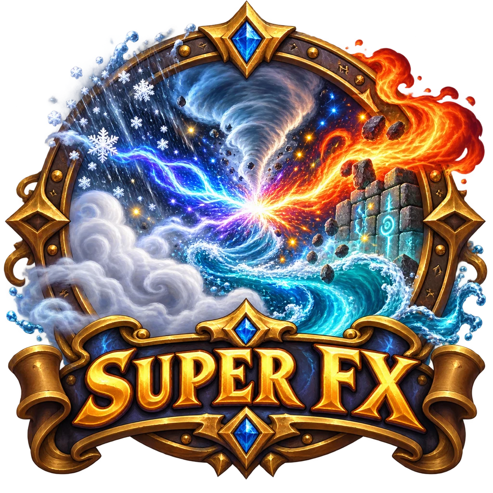

<p align="center"></p>

<h3 align="center">Effetti animati per le scene di Foundry VTT 13 e 14</h3>

<p align="center">Nebbia, pioggia, neve, fiumi che scorrono, trombe d'aria, raggi che si scontrano e muri luminosi · un pannello per il master · niente macro · qualsiasi sistema di gioco</p>

<p align="center">
  <a href="https://github.com/morningstar3010/super-fx/releases"></a>
  
  <a href="https://github.com/morningstar3010/super-fx/releases"></a>
</p>

<p align="center">
  <a href="README.md" title="English"></a>
  <a href="README.it.md" title="Italiano"></a>
</p>

<p align="center">
  🌐 <a href="README.md">English</a> · <b>Italiano</b>
</p>

---

**Super FX** dà vita alle tue scene. Aggiungi un effetto con un clic, lo vedi subito sulla mappa e lo regoli con i cursori mentre guardi: colore, intensità da 1 a 5, direzione, inclinazione, velocità. Ogni effetto può coprire tutta la scena o solo le Regioni che scegli, e le Regioni «Senza effetti» tengono pioggia e neve fuori da case, grotte e tende. Tutto è salvato nella scena, quindi viaggia insieme alle mappe e alle avventure che esporti.

## Indice

1. [Installazione](#install)
2. [Il primo effetto in un minuto](#quick-start)
3. [Aprire il pannello](#open-panel)
4. [Gli effetti](#effects)
5. [Dove si vede un effetto: aree e zone senza effetti](#areas)
6. [Raggi che si scontrano](#beams)
7. [Muri luminosi](#walls)
8. [Strumenti: combinazioni pronte, atmosfera cinematografica, copia](#tools)
9. [Impostazioni e lingua](#settings)
10. [Domande e problemi](#faq)
11. [Macro](#macros)

<a name="install"></a>
## 1. Installazione

1. In Foundry apri **Moduli aggiuntivi** e premi **Installa modulo**.
2. In basso, nel campo **URL del manifest**, incolla questo indirizzo e premi **Installa**:

```
https://github.com/morningstar3010/super-fx/releases/latest/download/module.json
```

3. Apri il tuo mondo, vai in **Gestisci moduli**, spunta **Super FX** e salva.

<a name="quick-start"></a>
## 2. Il primo effetto in un minuto

- [ ] Clicca il pulsante **Super FX – Pannello degli effetti** (la bacchetta magica) nella barra a sinistra.
- [ ] Nella scheda **Effetti** premi **Pioggia**: sulla mappa comincia a piovere.
- [ ] Apri il suo riquadro e porta **Intensità** a 5: mentre trascini la pioggia diventa **Tormenta**.
- [ ] Metti **Inclinazione** su **Dritta dall'alto** per vedere la pioggia cadere verso il pavimento, con gli schizzi dove tocca terra.
- [ ] Fatto! I giocatori vedono esattamente la stessa cosa.

<a name="open-panel"></a>
## 3. Aprire il pannello

Il pannello è solo per il master. Si apre in tre modi:

- con il pulsante della bacchetta nella barra a sinistra, negli strumenti Token, Regioni, Muri e Luci;
- con un tasto a tua scelta: **Configura comandi → Super FX → Apri il pannello di Super FX**;
- con una macro: `game.modules.get("super-fx").api.pannello()`.

Il pannello ha quattro schede: **Effetti**, **Raggi**, **Muri luminosi** e **Strumenti**. Lavora sempre sulla scena che stai guardando.

<a name="effects"></a>
## 4. Gli effetti

| Effetto | Che cosa fa | Opzioni principali |
|---|---|---|
| **Nebbia** | Banchi di nebbia che scorrono e si sfilacciano. Il livello 5 è un muro di nebbia | colore, intensità (Foschia → Muro di nebbia), direzione, velocità, grandezza |
| **Pioggia** | Dalla pioviggine alla tormenta, con schizzi e lampi a scelta | colore, intensità (Pioviggine → Tormenta), inclinazione (anche **dritta dall'alto**), direzione, velocità, schizzi, lampi, suono del tuono |
| **Neve** | Fiocchi che danzano nel vento, fino alla bufera | colore, intensità (Qualche fiocco → Bufera), inclinazione, direzione, velocità |
| **Grandine** | Chicchi che cadono veloci e rimbalzano | colore, intensità, inclinazione, direzione, velocità, schizzi |
| **Tempesta di sabbia** | Granelli spinti dal vento con un velo di polvere | colore, intensità (Brezza → Tempesta), inclinazione, direzione, velocità |
| **Foglie al vento** | Foglie che volteggiano girando su sé stesse | colore, intensità, inclinazione, direzione, velocità |
| **Braci** | Scintille e cenere ardente che salgono | colore, intensità, direzione, velocità |
| **Lucciole** | Punti di luce che vagano e pulsano | colore, intensità, velocità |
| **Liquido in movimento** | Fiumi, torrenti, paludi, sangue, lava, acido, energia magica | liquido, colore, intensità, direzione della corrente, velocità, grandezza, sotto i token |
| **Tromba d'aria / d'acqua** | Un vortice visto dall'alto, con detriti o spruzzi | tipo (aria, acqua, fuoco, magia), colore, intensità (Mulinello → Uragano), velocità, movimento, centro |
| **Fulmini** | Lampi e saette a caso, uguali per tutti i giocatori | colore, intensità, frequenza, suono del tuono, **Fulmine adesso** |
| **Oscurità magica** | Un velo d'ombra che respira | colore, intensità, velocità, grandezza |

Ogni riquadro ha anche **Area**, **Bordo sfumato** e **Solo per il master** (l'effetto lo vedi solo tu: comodo per prepararlo). I pulsanti nella testata del riquadro accendono e spengono l'effetto, lo spostano su o giù, lo duplicano e lo eliminano. **Accendi tutti** e **Spegni tutti** valgono per tutta la scena.

<details>
<summary><b>Inclinazione e direzione, spiegate</b></summary>

La **Direzione** è verso dove va il vento (o la corrente): 0° = destra, 90° = basso, 180° = sinistra, 270° = alto. Accanto al cursore una freccia la mostra.

L'**Inclinazione** è quanto il vento piega la caduta. Con **Dritta dall'alto** le gocce cadono verso il pavimento, come se la telecamera fosse sopra la mappa: corrono verso il punto in cui cadono e lì lasciano un anello. A 75° la pioggia è quasi orizzontale.
</details>

<details>
<summary><b>Fiumi e lava: come disegnarli</b></summary>

1. Apri gli strumenti delle **Regioni** e disegna un poligono che segue il fiume.
2. Seleziona la Regione e nel pannello premi **Liquido in movimento**: il liquido usa come area le Regioni selezionate. (Puoi anche spuntare la Regione dopo, nell'**Area** del riquadro.)
3. Scegli il **Liquido** e la **Direzione** della corrente.

Il liquido sta sotto i token, così chi guada il fiume resta visibile. Lava, acido ed energia magica brillano e fanno bolle.
</details>

<a name="areas"></a>
## 5. Dove si vede un effetto: aree e zone senza effetti

- **Area**: «Tutta la scena» oppure una o più Regioni spuntate nel riquadro.
- **Zone senza effetti**: Regioni con il comportamento **Super FX – Senza effetti**. Lì dentro gli effetti spariscono: tutti, oppure solo quelli scelti nel comportamento.
- **Maschera dai muri** (scheda Strumenti) trova da sola le stanze, gli edifici e le grotte chiusi dai muri e crea la Regione **Super FX – Interni** con il comportamento già pronto. Premilo di nuovo dopo aver cambiato i muri: aggiorna la stessa Regione.
- **«Senza effetti» sulle regioni selezionate** aggiunge il comportamento alle Regioni che hai selezionato.
- **Bordo sfumato** rende morbido il bordo di aree e zone, in caselle.

<a name="beams"></a>
## 6. Raggi che si scontrano

Un **gruppo di raggi** ha delle **fonti** (token oppure punti liberi sulla mappa, ognuno col suo colore) e, se vuoi, un **bersaglio**.

- **Senza bersaglio** i raggi si scontrano: con due fonti il punto di scontro va avanti e indietro, con tre o più si incontrano nel mezzo.
- **Con un bersaglio** (un token preso di mira o un punto) ogni fonte lo colpisce.
- Quando un token si muove, o trascini una maniglia, i raggi si allungano subito.
- **Lunghezza massima**: 0 = il raggio si allunga sempre; un numero = oltre quelle caselle il raggio si interrompe con uno sfrigolio e torna quando le fonti si riavvicinano.
- **Contro i muri**: il raggio **si ferma** al primo muro che blocca la vista, oppure lo **attraversa**.

Il modo più veloce: seleziona due o più token e premi **Scontro fra i token selezionati**.

I punti liberi hanno una **maniglia** rotonda che vede solo il master: trascinala per spostare il punto (tieni premuto Maiusc per agganciarla al centro della casella). Le maniglie si nascondono dalla scheda Strumenti.

<a name="walls"></a>
## 7. Muri luminosi

Rune su una parete, una barriera magica, lava nelle crepe, un campo di forza: scegli colore, intensità, pulsazione, larghezza e faville, seleziona i muri dal livello **Muri** (Maiusc + clic per sceglierne più di uno) e premi **Applica ai muri selezionati**. Il bagliore resta sul muro e lo segue se lo sposti. **Copia dal muro selezionato** carica nel pannello l'aspetto di un muro luminoso.

<a name="tools"></a>
## 8. Strumenti: combinazioni pronte, atmosfera cinematografica, copia

- **Combinazioni pronte**: Temporale, Pioggia, Pioggia dall'alto, Nevicata, Bufera di neve, Grandinata, Tempesta di sabbia, Palude nebbiosa, Bosco d'autunno, Incendio, Cripta maledetta, Tempesta magica, Vulcano. Aggiungono più effetti già regolati insieme; poi li cambi come vuoi.
- **Atmosfera cinematografica**: colori un po' spenti, ombre più profonde e un buio freddo, con il ciclo giorno/notte attivo. **Ripristina** rimette i valori di prima. Nella scena non cambia nient'altro.
- **Copia gli effetti su un'altra scena**.
- **Togli tutto da questa scena**: toglie tutti gli effetti e i raggi (i muri luminosi restano).

<a name="settings"></a>
## 9. Impostazioni e lingua

In **Impostazioni di gioco → Configura impostazioni → Super FX**:

- **Lingua di Super FX**: «Automatica» segue Foundry; altrimenti scegli English, Italiano, Deutsch o Español. Cambia solo i testi di Super FX.
- **Mostra gli effetti**: spegnilo per non vedere gli effetti solo su questo computer.
- **Qualità degli effetti**: Alta, Media o Bassa (quante particelle si disegnano). Abbassala sui computer lenti.
- **Maniglie sulla mappa** (master).

In **Configura comandi** puoi scegliere un tasto per aprire il pannello e uno per accendere e spegnere gli effetti.

<a name="faq"></a>
## 10. Domande e problemi

<details>
<summary><b>Piove dentro la casa</b></summary>

Premi **Maschera dai muri** nella scheda Strumenti, oppure disegna una Regione sopra la casa e premi **«Senza effetti» sulle regioni selezionate**.
</details>

<details>
<summary><b>Il computer rallenta</b></summary>

Metti **Qualità degli effetti** su Media o Bassa. Le particelle si creano solo nella parte di mappa che vedi, quindi le mappe grandi costano come quelle piccole.
</details>

<details>
<summary><b>I giocatori non vedono i fulmini</b></summary>

I fulmini li decide il master attivo e li manda a tutti: un master deve essere collegato.
</details>

<a name="macros"></a>
## 11. Macro

```js
const fx = game.modules.get("super-fx").api;
fx.pannello();                               // apre il pannello
fx.aggiungi("pioggia", { intensita: 5 });    // aggiunge una tormenta alla scena attuale
fx.preset("temporale");                      // aggiunge una combinazione pronta
fx.effetti();                                // elenco degli effetti della scena
fx.modifica(id, { colore: "#ff0000" });      // cambia un effetto
fx.spegni(id); fx.accendi(id);               // spegne / accende un effetto
fx.lampo(id);                                // fulmine adesso
fx.scontro(canvas.tokens.controlled);        // raggi fra i token selezionati
fx.mascheraDaiMuri();                        // crea la zona Interni dai muri
```

Tipi di effetto: `nebbia`, `pioggia`, `neve`, `grandine`, `sabbia`, `foglie`, `braci`, `lucciole`, `liquido`, `tromba`, `fulmini`, `oscurita`.

---

<p align="center">Realizzato da <b>MorningStar</b></p>
